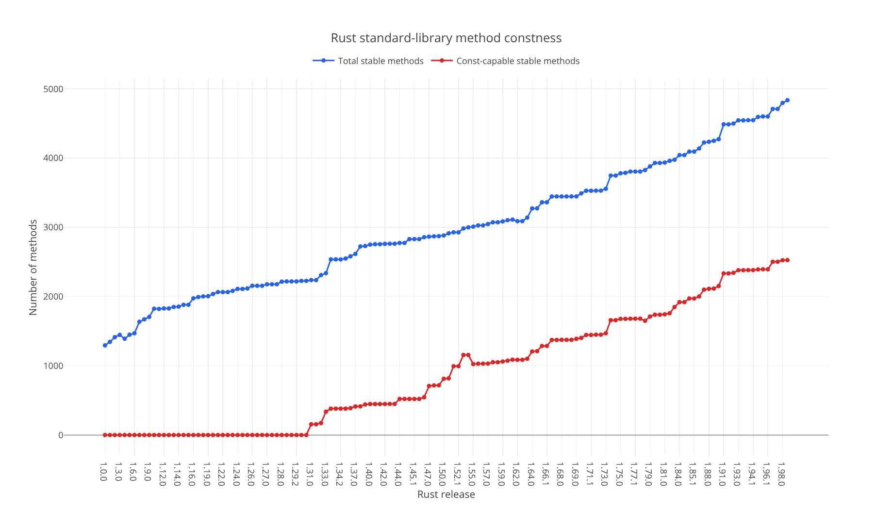

# rust-constness

Tracks the growth of const-capable APIs in Rust's standard library across
stable Rust releases.



The chart compares all stable public methods and associated functions with the
subset that can be called in stable const contexts. The underlying observations
are available in [`data/methods.json`](data/methods.json).

## Usage

Generate data and an interactive chart for a Rust release:

```bash
cargo run --release -- generate --version 1.98.0
```

An inclusive range can be used to compare releases over time:

```bash
cargo run --release -- generate --version 1.50-1.98
```

The command writes the dataset to `data/methods.json` and the chart to
`target/rust-constness.html`. To render the checked-in dataset without
downloading documentation again, run:

```bash
cargo run --release -- chart
```

## Adding a Rust release

Allowed release numbers are listed in
[`AVAILABLE_RELEASES`](src/versions.rs). To add the next stable release:

1. Append its full version number to `AVAILABLE_RELEASES`.
2. Regenerate the complete dataset and chart. For example, after adding Rust 1.99.0, run:

   ```bash
   cargo run --release -- generate --version 1.0-1.99
   ```

3. Refresh `assets/rust-standard-library-method-constness.png` from the generated chart.

## Methodology

Data is collected from the official `rust-docs` archives published for each
release. The count includes stable methods declared by inherent implementations
and public traits. Trait implementation copies, blanket implementations, and
synthetic implementations are excluded to avoid counting the same API more than
once. A method is considered const-capable only when its const support is stable
in that release.

## License

Licensed under the [MIT License](LICENSE).
